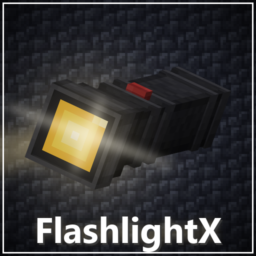

# FlashlightX

A handheld flashlight for Minecraft with a real directional beam. The light
goes where you look, runs on batteries you have to carry, and is visible to
other players in multiplayer.

<p align="center">
  
</p>

## Features

- **Directional beam** — a cone of ten rays reaching up to 14 blocks, brightest
  in the centre and fading with distance.
- **Works point-blank** — pressing the flashlight against a wall keeps the wall
  lit instead of going dark.
- **Passes through glass, doors, trapdoors and plants**, stops at solid blocks,
  and lights water sources.
- **Batteries** — one lasts three minutes, stacks to eight, and the flashlight
  automatically loads a spare from the inventory when the current one runs out.
  A charge bar on the item shows what is left.
- **Multiplayer** — every client draws the beams of nearby players holding a lit
  flashlight. The lighting is computed client-side; the server only syncs the
  on/off state of the item.
- **Animated model** — GeckoLib model with a button-press animation, a lens that
  glows while lit, and a raised arm pose.
- **Configurable** — beam shape, performance limits, visuals and battery
  behaviour.

## Supported versions

GeckoLib is required; it drives the animated model.

| Minecraft | Loader | GeckoLib | Sources |
|---|---|---|---|
| 1.21.1 | NeoForge 21.1+ | 4.6 – 4.9.3 | repository root |
| 1.20.1 | Forge 47+ | 4.4 – 4.4.9, 4.7 – 4.8.4 | [`1.20.1/`](1.20.1) |

GeckoLib 4.5 and 4.6 were never released for 1.20.1, which is why that range has
a gap. Versions 4.2.x and 4.3.x are not supported.

## Crafting

**Flashlight** — vertically, in any column:

| | |
|---|---|
| Redstone Lamp | top |
| Redstone Dust | middle |
| Iron Ingot | bottom |

**Battery** (makes 2) — vertically, in any column:

| | |
|---|---|
| Iron Nugget | top |
| Lime Wool | middle |
| Iron Nugget | bottom |

Both items are in the mod's own creative tab.

## Configuration

Two files are generated in `config/` on first launch.

`flashlightx-client.toml` covers everything drawn on the client:

| Section | Settings |
|---|---|
| `beam` | range, cone angle, brightness of the centre ray and each ring, minimum brightness, falloff, point-blank scale |
| `performance` | update interval, whether other players' beams are drawn, how many at once, maximum distance |
| `appearance` | glowing lens, raised arm and its angle |

`flashlightx-common.toml` covers the item itself:

| Section | Settings |
|---|---|
| `battery` | battery life, drain interval, automatic swapping, switching off when stowed, creative behaviour |
| `sound` | click on toggle and its volume |

## Building

Java 21 is needed for 1.21.1, Java 17 for 1.20.1. Both are fetched automatically
by the Gradle toolchain if missing.

```bash
./gradlew build            # 1.21.1 / NeoForge
cd 1.20.1 && ./gradlew build   # 1.20.1 / Forge
```

Jars end up in `build/libs/`.

## Repository layout

```
src/        1.21.1 NeoForge sources and assets
1.20.1/     1.20.1 Forge port, built separately
```

## Licence

[GPL-3.0](LICENSE).
